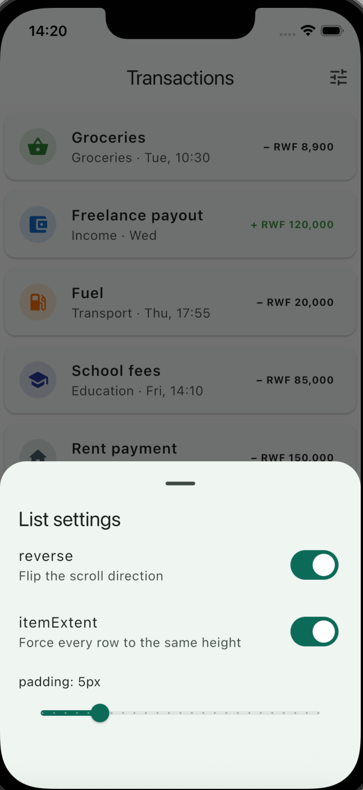

# List View Demo

A Flutter demo of `ListView.builder` showing a scrollable list of household transactions, where `reverse`, `padding`, and `itemExtent` change how the list looks and scrolls.

## Run it

```bash
flutter pub get
flutter run
```

Use the Chrome or emulator target, whichever you have.

## Widget overview

`ListView.builder` builds only the rows currently on screen, so it stays fast with long lists. Each row is a `Card` containing a `ListTile` with a category icon, title, date, and amount in RWF. Income is shown in green.

## Three attributes

- **`reverse`**: Flips the scroll direction so the first item sits at the bottom and the list starts from there. Toggle it in the settings sheet to see the change.
- **`padding`**: Adds space around the whole list, not around each card. The slider goes from 0 to 24px. At 0 the cards touch the screen edges, and higher values pull them inward.
- **`itemExtent`**: Forces every row to the same height (84px). When it's off, each row sizes to its content. Fixed heights let Flutter skip measuring each row, which helps with long lists.

## Settings

Tap the tune icon in the app bar to open the list settings. The switches and slider update the list immediately.

## Screenshot



Helped by Claude to some part of this README file
